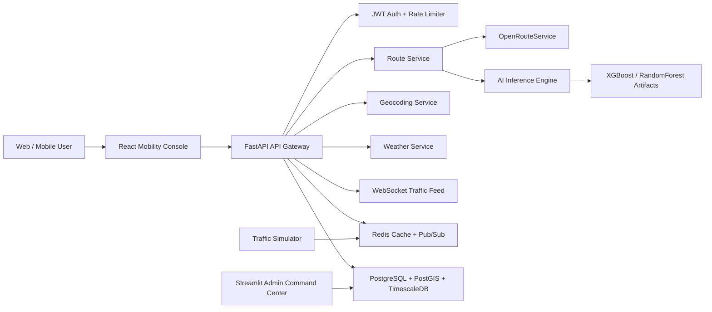

# FutureRoute AI

FutureRoute AI is an AI-powered urban mobility intelligence platform for predictive routing, congestion forecasting, weather-aware route scoring, safety analysis, and fleet/city mobility analytics.

This repository has been upgraded from a single Streamlit prototype into a production-style startup MVP architecture:

```text
FutureRoute AI
├── frontend/              React mobility console
├── backend/               FastAPI API gateway and services
├── ai_engine/             ML training, inference, graph algorithms
├── database/              PostGIS/Timescale schema
├── services/              Streaming/event simulators
├── analytics/             Streamlit admin command center
├── configs/               Environment templates
├── nginx/                 Frontend/API reverse proxy config
├── tests/                 Unit and API tests
├── models/                Production model registry placeholder
├── utils/                 Shared utility placeholder
└── assets/                Screenshots and presentation assets
```

## What Changed

| Old Prototype | Upgraded Platform |
|---|---|
| Single Streamlit file | React + FastAPI + AI engine + PostGIS architecture |
| Hardcoded API key | Environment-driven secrets |
| Random heatmaps | Traffic feature service and model-ready heatmap generation |
| Static safety values | Risk model interface with RandomForest training path |
| Fake future traffic | XGBoost/LSTM-ready prediction pipeline scaffold |
| No auth | JWT authentication and rate limiting |
| No database | PostGIS + Timescale schema |
| No realtime | WebSocket traffic updates and Redis streaming simulator |
| No tests | Unit/API tests and GitHub Actions |
| No deployment | Docker Compose, Nginx, CI/CD |

## Architecture



## Core Capabilities

- Full-screen interactive map
- Autocomplete geocoding
- Live location
- Multiple route candidates
- AI route ranking
- ETA confidence
- Weather-aware scoring
- Congestion heatmap points
- Incident overlays
- Turn-by-turn instructions
- Real-time traffic WebSocket
- Admin analytics panel
- JWT authentication
- Rate limiting
- Redis caching
- PostGIS/Timescale schema
- ML training and inference pipeline
- Dockerized deployment

## Local Development

1. Copy environment:

```bash
cp configs/.env.example .env
```

2. Add your OpenRouteService key to `.env`:

```bash
ORS_API_KEY=your_key_here
```

3. Start the platform:

```bash
docker compose up --build
```

4. Open:

- Frontend: `http://localhost:3000`
- Backend docs: `http://localhost:8000/docs`
- Health: `http://localhost:8000/health`

## Train AI Models

The project includes a deterministic synthetic mobility dataset generator so the ML pipeline runs before live city telemetry exists.

```bash
pip install -r backend/requirements.txt
python -m ai_engine.training.train_models
```

Artifacts are written to:

```text
ai_engine/artifacts/
```

Models currently implemented:

- XGBoost for ETA, congestion, fuel, and AI score prediction
- RandomForest for safety risk prediction
- Deterministic inference fallback when artifacts are missing
- Graph shortest-path algorithm for multi-objective routing research
- Reinforcement-learning reward scaffold for route policy research

## API Examples

Get token:

```bash
curl -X POST http://localhost:8000/api/v1/auth/token \
  -H "Content-Type: application/json" \
  -d '{"email":"demo@futureroute.ai","password":"demo-password"}'
```

Plan route:

```bash
curl -X POST http://localhost:8000/api/v1/routes/plan \
  -H "Authorization: Bearer TOKEN" \
  -H "Content-Type: application/json" \
  -d '{
    "source": {"lat": 33.5943, "lon": 73.0502},
    "destination": {"lat": 33.7294, "lon": 73.0379},
    "priority": "balanced"
  }'
```

## Recruiter Pitch

FutureRoute AI demonstrates:

- Geospatial systems engineering
- API integration and cache design
- ML-powered route ranking
- Explainable AI scoring
- Production backend architecture
- Real-time WebSocket updates
- PostGIS/Timescale data modeling
- Clean React product design
- Docker and CI/CD readiness

## Investor Positioning

FutureRoute AI should not be pitched as a direct consumer replacement for Google Maps. The stronger startup wedge is:

> Localized predictive mobility intelligence for fleets, logistics, emergency routing, and smart-city operators in complex urban environments.

Best B2B markets:

- Fleet routing
- City congestion dashboards
- Emergency response routing
- Weather-risk logistics
- Fuel optimization
- Road safety analytics

## What Still Separates This From Google Maps

This platform is now architecturally credible, but Google-scale systems still require:

- Massive live GPS telemetry
- Global road graph ownership
- Lane-level navigation
- Production map matching
- Incident detection from billions of signals
- Mature ETA models trained on years of traces
- Planet-scale distributed routing
- Deep mobile OS integration

FutureRoute AI is now a serious MVP foundation, not a finished Google Maps replacement.

